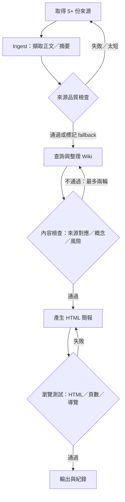

# Loop / Graph 設計

- **重複節點：** 來源擷取可能重試；Wiki 整理在內容驗證失敗時重做；HTML 在瀏覽測試失敗時重生。
- **檢查點：** Ingest 後先檢查資料品質，避免垃圾輸入污染 Wiki；Wiki 後檢查正確性與來源對應；HTML 後檢查可開啟性與投影片數。
- **設計原因：** 把錯誤盡量攔在上游，減少錯誤一路傳到簡報；限制迭代次數，控制成本與避免無限循環。
